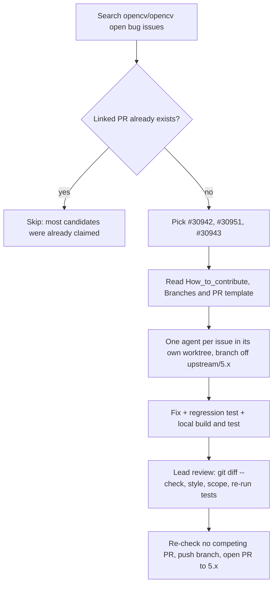
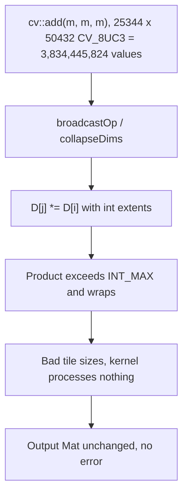
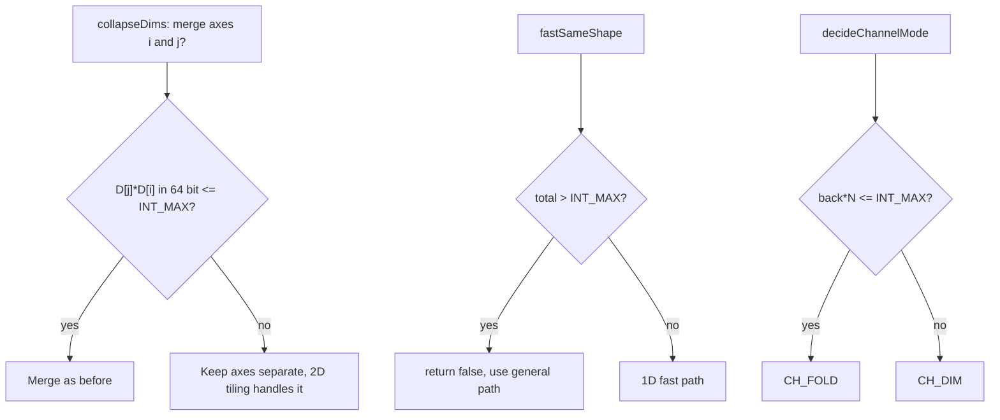
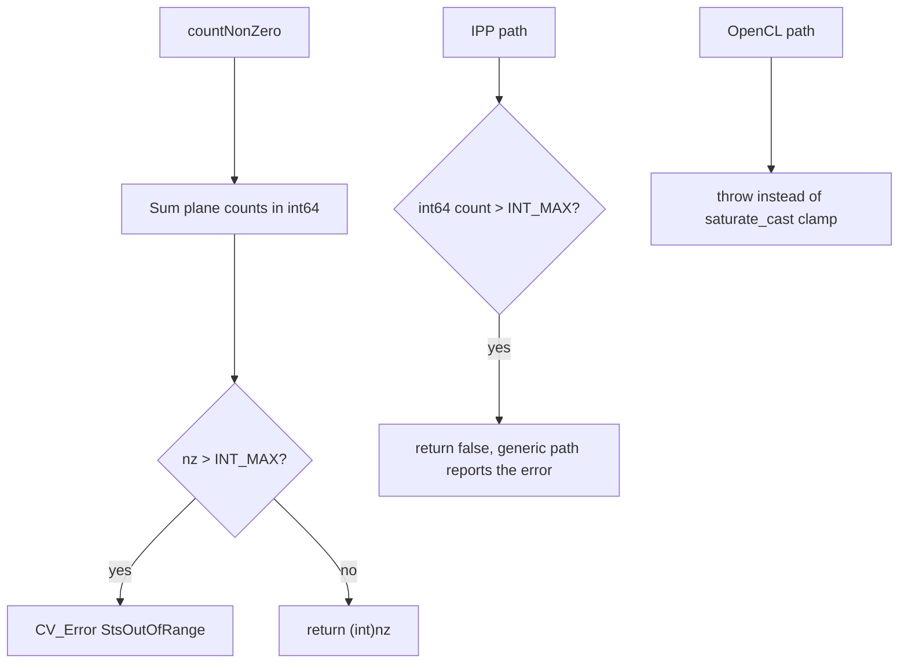
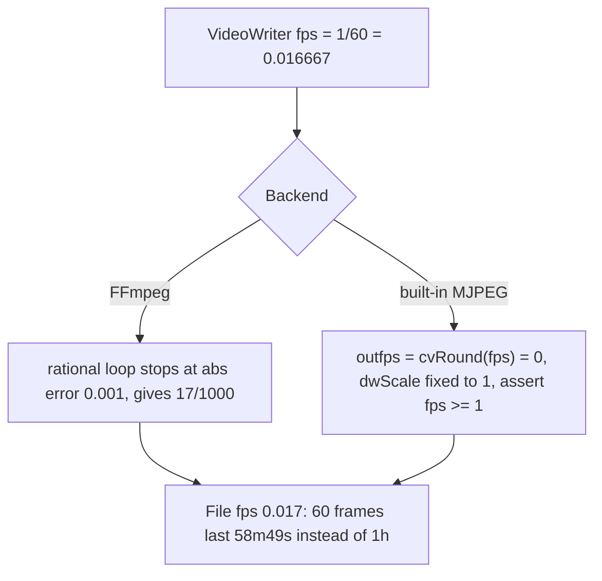
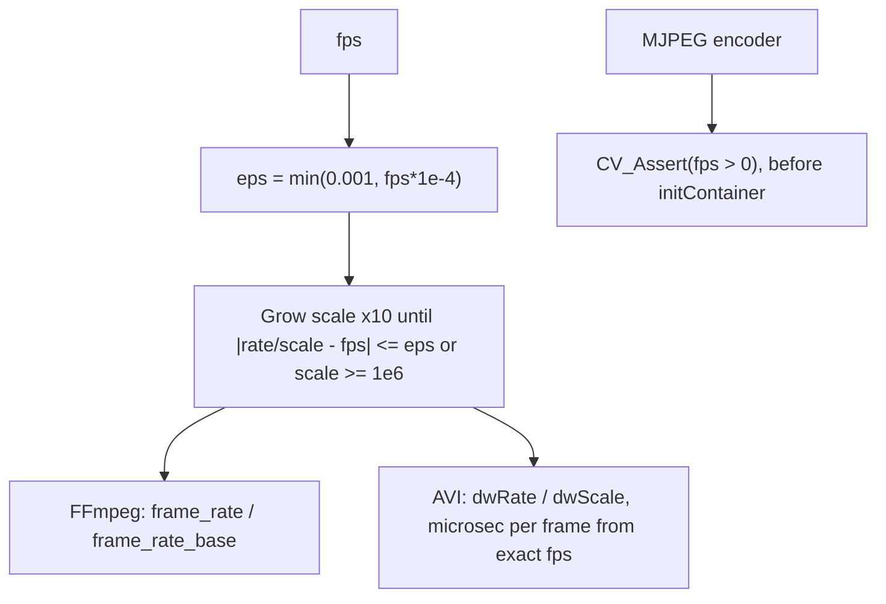

# Fix report: OpenCV issues #30942, #30951, #30943

Three open `opencv/opencv` bug issues that had no linked PR at the time (checked again right before submitting) were fixed on separate branches off `upstream/5.x`, one issue per PR as the contribution guide requires. PR titles carry the 🤖🤖🤖 suffix that the PR template asks of automated agents.

| Issue | Module | PR | Branch (replica on fork `tasktest06-star/opencv`) | Commit |
|---|---|---|---|---|
| [#30942](https://github.com/opencv/opencv/issues/30942) `cv::add` leaves large multi-channel Mat unchanged | core | [#30957](https://github.com/opencv/opencv/pull/30957) | `fix/issue-30942-collapsedims-overflow` | `614b7393` |
| [#30951](https://github.com/opencv/opencv/issues/30951) `countNonZero` returns a negative count | core | [#30958](https://github.com/opencv/opencv/pull/30958) | `fix/issue-30951-countnonzero-overflow` | `0fa562e1` |
| [#30943](https://github.com/opencv/opencv/issues/30943) non-integer fps rounded too much | videoio | [#30959](https://github.com/opencv/opencv/pull/30959) | `fix/issue-30943-videowriter-fps-precision` | `f993f1c2` |

## Process



Earlier PRs from the same account were closed as duplicates or already fixed, so only issues with no linked PR were taken.

## #30942: `cv::add` silently does nothing on huge multi-channel Mats

### Issue


### Modification


Files: `modules/core/src/broadcast.cpp`, `modules/core/test/test_arithm.cpp`.
Test `BroadcastOp.regression_30942_large_multichannel_no_int_overflow` uses headers aliasing a small buffer; it fails without the fix and passes with it.

### PR description
Fixes #30942

#### Problem

On 5.1.0 `cv::add(m, m, m)` on a large multi-channel array (e.g. 25344 x 50432 CV_8UC3, 3,834,445,824 elements) silently left the data unchanged. `modules/core/src/broadcast.cpp` stores extents as `int` and merged adjacent axes with `D[j] *= D[i]` (and channels with `shp[nd-1] *= cn`), so the product wrapped once it exceeded `INT_MAX`. 4.13 handled this because `getContinuousSize_()` multiplied in 64 bits and kept the row dimension when the count would overflow.

#### Changes (`modules/core/src/broadcast.cpp`)

1. `collapseDims`: do not merge two axes if `D[j] * D[i] > INT_MAX` (checked in 64 bits). The remaining 2D layout is handled by the existing tiling code.
2. `fastSameShape`: return `false` instead of `CV_Assert(total <= INT_MAX)`, so the general path takes over.
3. `decideChannelMode`: use `CH_DIM` instead of `CH_FOLD` when `back * N > INT_MAX`.

#### Test

`BroadcastOp.regression_30942_large_multichannel_no_int_overflow` runs `broadcastOp` on 25344 x 50432 CV_8UC3 headers that alias one small buffer (no multi-GB allocation; the body never dereferences data) and checks that tile sizes are positive and sum to rows*cols*cn. Run for a same-shape pair and for a 1-row broadcast operand.
It **fails without the fix and passes with it** (verified locally on aarch64, gcc 13.3).

#### Not verified

- The test exercises the broadcast driver, not an end-to-end `cv::add` on 3.8 GB Mats (not possible on my machine); I did not confirm every arithm kernel accepts the resulting tiles.
- A run of the existing `*Broadcast*`/arithmetic tests was cut short by a time limit; no failures were seen in the part that completed. Please rely on CI for the full suite.
- I could not explain why the reporter saw a silent no-op rather than the `CV_Assert` in `fastSameShape`; the fix covers both paths.

#### Pull Request Readiness Checklist

See details at https://github.com/opencv/opencv/wiki/How_to_contribute#making-a-good-pull-request

- [x] I agree to contribute to the project under Apache 2 License.
- [x] To the best of my knowledge, the proposed patch is not based on a code under GPL or another license that is incompatible with OpenCV
- [x] The PR is proposed to the proper branch (5.x, bug fix)
- [x] There is a reference to the original bug report and related work
- [x] There is accuracy test, performance test and test data in opencv_extra repository, if applicable (regression test added, no extra data needed)
- [x] The feature is well documented and sample code can be built with the project CMake (no API change)

## #30951: `countNonZero` returns a negative count above INT_MAX

### Issue
```mermaid
flowchart TD
    A["countNonZero on 35000 x 70000 mask of ones"] --> B["NAryMatIterator planes, each <= INT_MAX"]
    B --> C["int nz += func(plane)"]
    C --> D["2,450,000,000 wraps to -1,844,967,296"]
    D --> E[Caller sees negative count, e.g. countNonZero(mask) > 0 is false]
```

### Modification


Files: `modules/core/src/count_non_zero.dispatch.cpp`, `modules/core/test/test_arithm.cpp`.
Note: a first draft with a chunking loop and a zero-step Mat header test was dropped; the zero-step test segfaulted because `NAryMatIterator` treats step 0 as contiguous.

### PR description
Fixes #30951

#### Problem

`cv::countNonZero` returns a negative `int` when the result exceeds `INT_MAX` (e.g. -1844967296 instead of 2450000000 for a 70000 x 35000 mask of ones). `NAryMatIterator` never merges dimensions past an int-sized plane, so each plane count is valid, but the per-plane results were summed into an `int` which wrapped.

#### Changes (`modules/core/src/count_non_zero.dispatch.cpp`)

No public API or ABI change.
- Generic path: accumulate in `int64`; if the total exceeds `INT_MAX` raise `CV_Error(Error::StsOutOfRange, ...)` instead of returning a wrapped value.
- IPP path: compute in `int64`; return `false` above `INT_MAX` so the generic path reports the error.
- OpenCL path: raise the same error instead of silently clamping with `saturate_cast<int>`.

A 64-bit counting API (also suggested in the issue) is a separate public-API decision and is not part of this PR.

#### Test

`Core_CountNonZero.overflow_int_range_continuous` (tagged `CV_TEST_TAG_MEMORY_6GB`, `CV_TEST_TAG_LONG`, so skipped by default): the exact 35000 x 70000 case from the issue must throw, and a 1 x INT_MAX view must return exactly `INT_MAX`.

Verified locally (aarch64, gcc 13.3, core only, IPP/OpenCL/CUDA off): the 56 existing `*CountNonZero*` tests pass and the new test passes with `--test_tag_enable=mem_6gb`.

#### Not verified

- The IPP and OpenCL edits were not compiled or run (those backends are off in my build); please rely on CI / review by eye.
- I did not run the new test against the unfixed code, nor the full `opencv_test_core` suite.

#### Pull Request Readiness Checklist

See details at https://github.com/opencv/opencv/wiki/How_to_contribute#making-a-good-pull-request

- [x] I agree to contribute to the project under Apache 2 License.
- [x] To the best of my knowledge, the proposed patch is not based on a code under GPL or another license that is incompatible with OpenCV
- [x] The PR is proposed to the proper branch (5.x, bug fix)
- [x] There is a reference to the original bug report and related work
- [x] There is accuracy test, performance test and test data in opencv_extra repository, if applicable (regression test added, no extra data needed)
- [x] The feature is well documented and sample code can be built with the project CMake (no API change)

## #30943: VideoWriter rounds low non-integer fps

### Issue


### Modification


Files: `cap_ffmpeg_impl.hpp`, `container_avi.cpp`, `container_avi.private.hpp`, `cap_mjpeg_encoder.cpp`, `test_video_io.cpp`.

### PR description
Fixes #30943

#### Problem

`VideoWriter` with a low non-integer fps (e.g. 1/60) writes a file whose fps is rounded (0.017), so a 60-frame video lasts 58m49s instead of 1h. Two independent roundings:

1. FFmpeg writer (`cap_ffmpeg_impl.hpp`, `icv_configure_video_stream_FFMPEG`): the rational approximation loop stops at an absolute error of 0.001, so 1/60 becomes 17/1000. This is most likely the path hit by the reporter (Windows wheel, .avi); I could not confirm on Windows.
2. Built-in MJPEG/AVI writer (`container_avi.cpp`): stored `cvRound(fps)` as an int with dwScale fixed to 1, so fps < 1 became 0 and non-integer fps were rounded; `cap_mjpeg_encoder.cpp` asserted `fps >= 1`.

#### Changes

- FFmpeg: tolerance is now `min(0.001, fps * 1e-4)` (unchanged for fps >= 10) and the denominator is capped below 1e6 so the loop always terminates.
- AVI writer: write dwRate/dwScale using the same logic, compute microseconds-per-frame from the exact fps; `outfps` is now `double`. The reader already computes fps as dwRate/dwScale.
- MJPEG encoder: `CV_Assert(fps > 0)` (before `initContainer`) replaces `fps >= 1`.

Ordinary values are unchanged: 25 and 30 fps still give scale=1; 29.97 now gives 2997/100 instead of being rounded to 30.

#### Test

`Videoio_MJPEG.low_non_integer_fps_precision` writes a 2x2 MJPG .avi at fps = 1/60 with `CAP_OPENCV_MJPEG` and expects `CAP_PROP_FPS` within 1e-5. `Videoio_MJPEG.*` passes locally (aarch64, gcc 13.3).

#### Not verified

- The FFmpeg change is untested (my build used `WITH_FFMPEG=OFF`), as is the Windows repro. I did not run the output through ffprobe.
- I did not watch the new test fail before the fix (before it, `CV_Assert(fps >= 1)` throws).
- `videoio_builtin.basic_avi` fails locally because opencv_extra test data is not available; it only parses an existing file and I believe it is unrelated, but did not confirm on unmodified upstream.

#### Pull Request Readiness Checklist

See details at https://github.com/opencv/opencv/wiki/How_to_contribute#making-a-good-pull-request

- [x] I agree to contribute to the project under Apache 2 License.
- [x] To the best of my knowledge, the proposed patch is not based on a code under GPL or another license that is incompatible with OpenCV
- [x] The PR is proposed to the proper branch (5.x, bug fix)
- [x] There is a reference to the original bug report and related work
- [x] There is accuracy test, performance test and test data in opencv_extra repository, if applicable (regression test added, no extra data needed)
- [x] The feature is well documented and sample code can be built with the project CMake (no API change)

## Verification summary and honest caveats

- Built and tested on aarch64, gcc 13.3, minimal module builds (IPP, OpenCL, CUDA, FFmpeg off).
- #30942: new test fails without the fix, passes with it. A broader existing-test run was cut short by a time limit.
- #30951: 56 existing tests plus the new 6 GB-tagged test pass. IPP/OpenCL edits not compiled.
- #30943: built-in MJPEG tests pass. FFmpeg path and the Windows repro untested.
- All PRs rely on upstream CI for full coverage.
